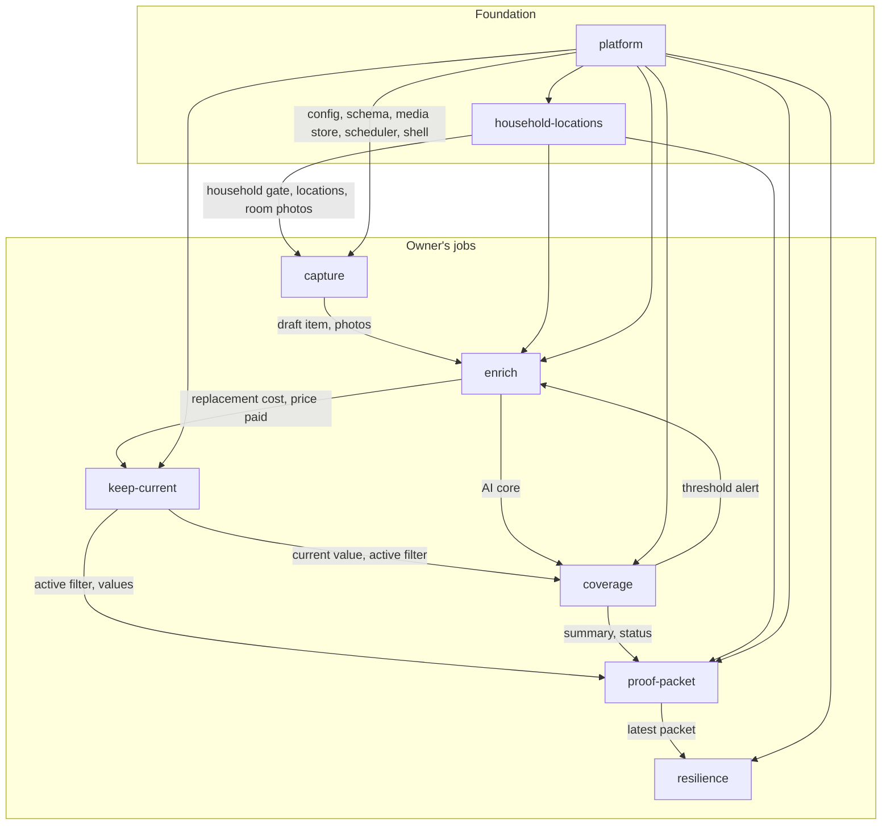

# High-Level Design: DomicileDB

## Problem

After a fire, flood, or theft, homeowners under-claim because they cannot remember what they
owned, cannot prove they owned it, and do not know whether what they owned exceeded their
policy's personal-property limit. A spreadsheet started with good intentions goes stale, has no
photos or receipts, and burns with the house. The adjuster's conversation is won by the person
with a credible, current, photo-and-receipt-backed record that survived the event.

## Approach

DomicileDB is a self-hosted, single-user home-inventory app built around one question: **does
this help the user win the claim conversation and get paid?** It attacks the problem on four
fronts, each a segment of the design tree:

- **Capture fast, enrich later.** A mobile-first loop saves a draft from one or more photos in
  seconds with no required fields; a worklist, an autosaving editor, and consent-gated AI assist
  fill in identity, serials, descriptions, and values afterward.
- **Keep the insurance picture live.** Every item's replacement cost, times quantity, over active
  items only, is compared to Coverage B – Personal Property from the owner's real declarations
  page. Status is ambient on the dashboard and nudges at 80% and 100% right where the owner is.
- **Produce the claim document.** A print-ready proof packet organizes the inventory by room with
  photos, specs, values, attached-document kinds, totals, and the coverage position.
- **Make the data survive the event.** Off-site S3 backup of the database snapshot, every photo
  and document, and the latest packet; a full ZIP export; a restore runbook.

Underneath sits a deliberately boring platform: one SQLite file and one media directory, operator
configuration from the environment only, uploads admitted by their bytes, a hardened media route,
a PWA that caches the app but never the inventory, and a distroless signed container.

## Target Users

One homeowner who self-hosts, owns and edits the inventory alone, and shares it only by handing
someone a report. They have little patience for data entry, capture in short bursts on a phone,
and finish details later. The operator who deploys the container is usually the same person
wearing a different hat: they set the backup target, the AI key, and the thresholds; they never
make those choices inside the app.

## Goals

- A draft item can be created from a photo in seconds, over plain HTTP, with nothing typed.
- The dashboard always shows the active replacement-cost total against Coverage B, with unvalued
  items counted and surfaced, and the status changes the moment an item is valued, added, or
  marked sold.
- The proof packet for the whole household or any room or category downloads on demand and would
  be accepted by an adjuster as a credible starting point.
- With `S3_BUCKET` set, the snapshot, media, and latest packet are in the bucket within one cron
  cycle of any change, and `npm run restore` rebuilds a working `DATA_DIR` on a new machine.
- Nothing AI-derived is ever saved without the owner seeing what was sent and confirming the
  result.
- Falsification signals: a capture that demands a field before saving; a sold item still in the
  total; a packet that disagrees with the dashboard; a backup that silently stopped; an AI value
  stored without a consent step.

## Non-Goals

- Per-category sub-limits, scheduled-item riders, deductible math, or the two-step Limited
  Replacement Cost recovery; v1 models the overall Coverage B limit only.
- Multiple users, roles, or accounts; multiple properties; emergency read-only family access.
- Built-in authentication; the network boundary is the security boundary.
- Automated market re-pricing, insurer integration, multi-currency.
- Structured or spreadsheet export as a product feature; the ZIP export exists for resilience and
  portability, not analysis.
- Any end-user settings screen; thresholds, cadences, and credentials are operator configuration.

## Tenets

Ordered so that when two conflict, the higher one wins.

- **Claim-grade over convenient.** When a shortcut would make entry easier but the data weaker as
  evidence (a guessed serial, an unverified value), keep the evidence standard and accept the
  friction or the blank.
- **Nothing leaves the house silently.** When a feature would move data off the owner's machine,
  it is operator-configured or consented per action with the payload shown; never automatic,
  never implied.
- **Drafts are data.** When choosing between rejecting incomplete input and accepting it, accept
  it, store it, and nudge; completeness is the owner's call.
- **Conservative numbers.** When two defensible figures exist, show the one that makes
  underinsurance more visible: replacement cost over price paid, "at least $X" over a total that
  hides unvalued items, 100% as approaching rather than safely within.
- **The operator turns the knobs; the owner owns the content.** When something could be a user
  preference or an environment variable, it is an environment variable.
- **Fail loud on configuration, fail soft on features.** Invalid operator config stops the
  server; an unconfigured feature is a clean, visible no-op.

## System Design

Runtime shape: a Next.js App Router server (Node runtime, standalone output) in a distroless
container. Server components read through `src/lib/queries/*`; mutations are Server Actions in
`src/lib/actions/*` validated with Zod; pure rules (`coverage.ts`, `money.ts`, `report.ts`) are
dependency-free and unit-gated at 100%. Drizzle over better-sqlite3 in WAL mode holds the data;
sharp writes original, web, and thumbnail variants to `DATA_DIR/media`; `@react-pdf/renderer`
builds the packet in-process; the AWS S3 client syncs to any S3-compatible bucket; OpenRouter is
called with `fetch` so the exact payload is known and shown.

| Segment | Owns | Design doc |
|---|---|---|
| capture | Snap-to-draft loop; shared upload admission | `docs/intent/capture/capture-design.md` |
| enrich | List, worklist, editor, photos, documents, categories, AI core | `docs/intent/enrich/enrich-design.md` |
| coverage | Replacement-cost total vs. Coverage B; money; policy record; dec-page pre-fill | `docs/intent/coverage/coverage-design.md` |
| proof-packet | Assembly and PDF of the claim document | `docs/intent/proof-packet/proof-packet-design.md` |
| keep-current | Lifecycle, valuation history, reminders | `docs/intent/keep-current/keep-current-design.md` |
| resilience | Backup, export, restore, single-flight guards | `docs/intent/resilience/resilience-design.md` |
| household-locations | Single household, onboarding, locations, room photos | `docs/intent/household-locations/household-locations-design.md` |
| platform | Config, boot, schema, media store and serving, PWA shell, container and CI | `docs/intent/platform/platform-design.md` |

The arrow overlay (`docs/arrows/index.yaml`, one doc per segment) tracks each segment's mapping
and audit state.

## Key Design Decisions

1. **Replacement cost of active items is the spine.** Alternatives: price paid, actual cash
   value, or whichever the policy uses. Replacement cost is the most conservative figure and the
   one a replacement-cost policy pays against; only `active` items count so disposals drop out
   immediately; unvalued items are excluded and counted so the total reads "at least".
   Sub-limits and deductible math are deferred because they are not on the declarations page.
2. **No required fields, ever.** Alternatives: a required title or photo, a completeness
   checklist. A half-finished item is always acceptable; the worklist and hints nudge, and the
   owner marks completeness. This is what makes burst capture on a phone work.
3. **AI is preview → consent → execute → review → apply.** Alternatives: auto-fill from photos,
   background enrichment. The owner sees the model, the literal prompt, and the photos before
   anything is sent, and edits before anything is saved; prompts forbid guessing serials; schemas
   strip anything the model invents; calls are logged and capped per hour.
4. **One SQLite file plus a media tree under `DATA_DIR`.** Alternatives: Postgres, blobs in the
   database, cloud storage as primary. A single file is a trivially consistent `VACUUM INTO`
   snapshot; content-addressed media files make S3 sync "upload what is absent"; paths stored
   relative to `DATA_DIR` make restore mount-independent; no database engine in the image.
5. **Integer cents everywhere; one conversion module.** Alternatives: floats, a decimal library.
   Totals that reach a claim must not drift; `money.ts` is the only dollars↔cents edge and is
   unit-gated at 100%.
6. **Operator configuration from the environment, read in one validated place.** Alternatives:
   a settings UI, config files. Backup target and cadence, AI credentials, and thresholds are
   deployment decisions; one reader makes "exactly what is read" auditable and lets invalid
   config fail before the server serves.
7. **No application authentication; the network is the boundary.** Alternatives: built-in login,
   OAuth. A single owner on a private network does not need accounts, and the choice drives the
   rest of the security model: media responses are `no-store`, the service worker never caches
   the inventory, the resilience page never shows bucket or endpoint, and backup failures expose
   no SDK detail.
8. **Uploads are admitted by their bytes and photos are re-encoded.** Alternatives: trust the
   declared MIME, allow SVG. A renamed SVG or HTML file must never reach the image pipeline or be
   served back; the serving route is the only user-input → file-read path and is layered against
   traversal, symlinks, size, and caching.
9. **Exactly one household, enforced by the database.** Alternatives: application check only,
   multi-tenant from day one. The singleton column makes every downstream query simpler and
   closes the race the application check left open.

## Success Metrics

- Time from opening the app to a saved draft on a phone: a few seconds, no typing required.
- Coverage status on the dashboard matches a hand calculation of active replacement cost against
  Coverage B for every test fixture, and changes within one page load of any edit.
- The whole-household proof packet renders for the owner's real inventory without hitting the
  item cap, and its grand total equals the dashboard total.
- A fresh container, `S3_*` configured, `npm run restore`: the inventory, photos, and documents
  come back byte-identical (the CI round trip proves this on every push).
- Zero AI-derived values in the database without a corresponding logged interaction.

## FAQ

**Why is 100% of Coverage B "approaching" and not "over"?** Because at exactly the limit the
claim would not be cut; "over" is reserved for the case where it would.

**Why does deleting a location not delete its items?** A room can stop existing without its
contents vanishing; items become "Unassigned", which is already a first-class room in the packet.

**Why is there a ZIP export when the spec defers structured export?** The ZIP is a resilience and
anti-lock-in measure (database snapshot plus every file), not an analysis format.

## References

- Product spec: `feature-spec.md`. Grounding policy: `declarations.md` (HO-3, Coverage B
  $456,750).
- Implementation notes: `docs/architecture.md`, `docs/configuration.md`, `README.md`.
- Design tree: `docs/intent/<segment>/<segment>-design.md` and `<segment>-specs.md` for the
  eight segments above; arrow overlay in `docs/arrows/`.
- Security regression index: `tests/unit/*.security.test.ts` (VULN-001 to VULN-023).
